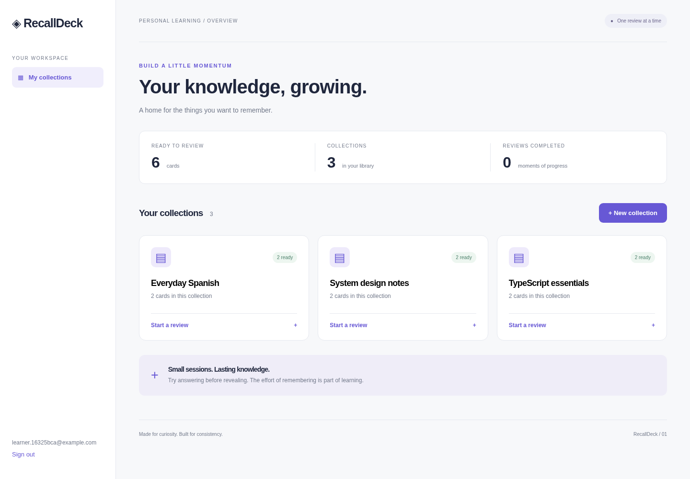
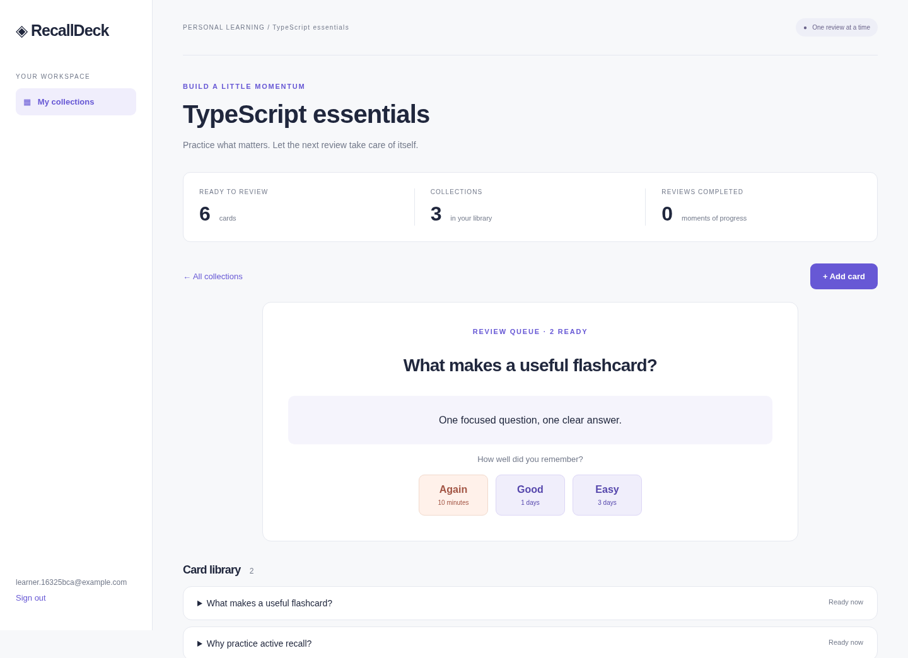
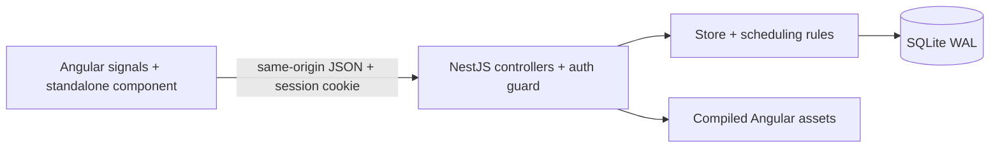

# RecallDeck

**Make knowledge stick, one review at a time.**

A personal flashcard workspace built with **Angular 21, NestJS 11 and TypeScript**. Turn notes into focused questions, practice active recall, and let a simple spaced-repetition scheduler plan the next review.



## What you can do

- Create a private account and organize flashcards into collections.
- Add question/answer cards, reveal answers, and rate recall as **Again**, **Good**, or **Easy**.
- Work through a queue containing only cards due for review.
- Browse every card and its next review date, including cards not currently due.
- Track completed reviews and resume after signing in again.
- Use the same responsive interface on desktop and mobile.

Review submissions use **idempotency keys**, **card versions**, and **SQLite transactions**. A repeated request cannot count the same review twice; a stale browser tab cannot silently overwrite a newer review.

## Run locally

Requires **Node.js 24.22+** and npm. Node's built-in `node:sqlite` module is used directly; it currently emits an experimental warning.

```sh
npm ci
npm run build
npm start
```

Open **http://localhost:8000**. The NestJS process serves both the compiled Angular application and `/api`. Create your own account; no demo credentials or seed accounts are shipped.

For development, run these commands in separate terminals:

```sh
npm run dev:api
npm run dev:web
```

Open **http://localhost:5178**. Angular proxies `/api` to port 8000.

The default accepted browser origin is `http://localhost:8000`. To change it, set:

```sh
APP_ORIGIN=https://your-domain.example npm start
```

SQLite data lives in `var/recalldeck.sqlite`, outside version control. Back up the database using SQLite's backup mechanism, or stop the process before copying the database and associated WAL files.

## Scheduling rules

This is a small, transparent interval scheduler, **not an implementation of FSRS or SM-2**:

| Rating | Next interval |
| --- | --- |
| Again | 10 minutes; resets the day interval to zero |
| Good | Twice the previous day interval, minimum 1 day |
| Easy | Three times the previous day interval, minimum 3 days |

Day intervals are capped at 365 days. A day means 24 elapsed hours, independent of daylight-saving changes. New cards are immediately due. The server decides whether a card is due and records the review atomically.



## Architecture



- **Frontend:** Angular standalone application, signals, computed review queue, native forms and responsive CSS. No external font, AI or analytics service is required.
- **Backend:** NestJS controllers and session guard; typed TypeScript domain store with prepared SQL statements.
- **Persistence:** users, hashed sessions, collections, cards, and append-only review records. Foreign keys, uniqueness constraints and a transaction protect review integrity.
- **Authentication:** scrypt password hashes with per-account salts; random 256-bit session tokens stored as SHA-256 digests; HttpOnly, SameSite=Strict cookies; 24-hour session expiry and server-side logout.
- **Browser request protection:** explicit allowed origin, cross-site fetch rejection, no permissive CORS. Authentication attempts are limited to 30 per 15-minute window per socket IP in the current process.

See [architecture and tradeoffs](docs/architecture.md) and the [API reference](docs/api.md).

## Validation

```sh
npm test
npm run build
npx playwright install chromium --only-shell
npm run test:e2e
```

The browser suite starts its own API and Angular server on ports 8000 and 5178. Keep these ports free. It uses a separate `var/e2e.sqlite` database. Screenshot fixtures use fictional study content.

Coverage includes deterministic scheduling, account isolation, password/session verification, expiration, duplicate requests, stale versions, early-review rejection, transaction rollback, input limits, API origin checks, and the complete browser review flow. Browser tests also check mobile overflow. GitHub Actions runs the build and both suites.

## Configuration and deployment

| Variable | Default | Purpose |
| --- | --- | --- |
| `PORT` | `8000` | HTTP listener |
| `DB_PATH` | `var/recalldeck.sqlite` | Persistent SQLite path |
| `APP_ORIGIN` | `http://localhost:8000` | Exact permitted browser origin, including port |
| `NODE_ENV` | unset | `production` enables Secure session cookies |

A Dockerfile and Compose configuration are included. For a local container, run `docker compose up --build` and open http://localhost:8000. For public hosting, set `NODE_ENV=production`, set `APP_ORIGIN` to the public HTTPS origin, terminate TLS at the reverse proxy, and mount persistent storage for `/app/var`.

This repository publishes the source; it does not include a hosted demo. The Docker configuration is provided for deployment and has not been exercised in this development environment.

## Scope

The current release focuses on collection creation, card creation and review scheduling. Card editing/deletion, imports, password recovery, email verification, reminders and collaborative collections are not included. The scheduler makes no personalized retention prediction. SQLite and synchronous scrypt suit a small single-process installation; a multi-instance service needs a shared database and rate-limit store, asynchronous password hashing, and an explicit proxy trust policy. There is no automated database migration framework yet.

## License

[MIT](LICENSE)
